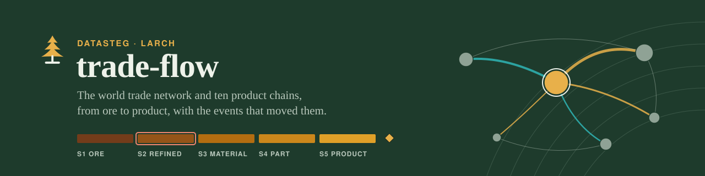

# Larch: trade-flow's design system

Larch is the design system of [trade-flow.datasteg.com](https://trade-flow.datasteg.com). This page describes it as
applied in this repository. The source of truth is [design/tokens.json](design/tokens.json); it generates
[design/tokens.css](design/tokens.css) (`packages/tokens-build/build.mjs`, or `scripts/tokens_css.py`, byte for
byte the same), and [design/larch.css](design/larch.css) holds the component styles. Every colour, size and space
in the app comes from a token: components write `var(--token)`, never a literal value.

## The idea

A mountain forest in late October, walked on a marked trail. The larch is the one conifer that turns gold and sheds
its needles: its gold is the system's single action colour. The rest of the palette is the forest floor (mist,
lichen, granite, spruce, moss), with one red, the rowan berry, kept for chokepoints. A product chain is a trail from
ore to product, so the furniture of Alpine walking trails runs through the components:

- the **trail marker**, a gold square turned 45° with a spruce edge, marks the selected stage and the trail;
- the **TrailHead**, a deep canopy-green band with contour lines, opens every chain page;
- **Signposts**, after the yellow signs on Swiss walking trails, point to the next and previous stage, with a
  "walking time" column for the value step;
- the **stage ramp** runs from bark brown at the roots (ore) to gold at the crown (the product a household buys);
- **maps** are drawn like topographic sheets: land a shade off the ground, borders cut in the ground colour,
  region names spaced in small capitals.

There are two themes, **Morning** (light) and **Dusk** (dark). Both are defined token by token, not inverted.

## Palette

Hex values are the generated `tokens.css`; aliases (`{name}` in tokens.json) are resolved per theme.

### Identity: the forest

| Token | Morning (light) | Dusk (dark) | Use |
|---|---|---|---|
| `--mist` | `#F4F6F0` | `#F4F6F0` | Morning mist between the trees: the page ground by day (`surface`). |
| `--firn` | `#FBFCF9` | `#FBFCF9` | First snow on the peaks above the forest: raised panels by day (`surface-raised`). |
| `--lichen` | `#E8EDE4` | `#E8EDE4` | Pale lichen on granite: sunken fields, control tracks and the land on maps by day. |
| `--larch` | `#E2A73A` | `#E8B04A` | THE Larch colour: larch needles in late October. The action fill (`accent`), the selected economy, the trail marker. `spruce` text on it (7.6:1 by day). |
| `--resin` | `#8A5600` | `#EDB95A` | Larch resin: the text-safe gold for kickers, stage numerals and the emphasised series. 5.6:1 on `mist` by day, 9.9:1 on `spruce-night`. |
| `--spruce` | `#14231B` | `#14231B` | Spruce and stone pine, nearly black: ink by day and the text on every gold fill. |
| `--spruce-night` | `#111A15` | `#111A15` | The forest at dusk: the page ground by night. |
| `--canopy-green` | `#1E3B2C` | `#1F3A2C` | Under the canopy: the deep block behind trail heads and the download band, in both themes. |
| `--moss` | `#1C6644` | `#93D3AC` | Moss on the north side of the trunk: links and the focus ring by day (`link`). |
| `--rowan-red` | `#B0352A` | `#F0866F` | Rowan berries: the one red in the forest. Chokepoints, and the editor's voice. One per screen. |
| `--granite` | `#7F8C81` | `#6F8476` | Granite boulders on the path: control borders (`line-strong`). |

### Surfaces, lines and ink

| Token | Morning (light) | Dusk (dark) | Use |
|---|---|---|---|
| `--surface` | `#F4F6F0` | `#111A15` | Page ground and the map's sea. Text: `ink`, `ink-secondary`, `ink-muted`. |
| `--surface-raised` | `#FBFCF9` | `#18231D` | Panels that sit over the map (filter rail, drawer, tooltip), cards and tables. |
| `--surface-sunk` | `#E8EDE4` | `#0C130F` | Control tracks (segmented control, slider), code chips, the time strip. |
| `--line` | `#D5DCD1` | `#2A382F` | 1px hairlines between rows and around panels. Decorative only, never a control's only edge. |
| `--line-strong` | `#7F8C81` | `#6F8476` | Borders of inputs, buttons and the time strip; 3.2:1 on `surface` by day, 4.4:1 by night. |
| `--ink` | `#14231B` | `#E8EDE5` | Body text and headings on `surface`, `surface-raised` and `surface-sunk` (13.7:1 or more in both themes). |
| `--ink-secondary` | `#3D4F43` | `#BAC7BC` | Deks, labels, legend text, table headers. 8.0:1 on `surface` by day, 10.1:1 by night. |
| `--ink-muted` | `#56675B` | `#93A497` | Metadata, axis ticks, source lines, the HS chapter name. 5.1:1 on `surface-sunk` by day; 6.2:1 on `surface-raised` by night. |

### Action, links and emphasis

| Token | Morning (light) | Dusk (dark) | Use |
|---|---|---|---|
| `--accent` | `#E2A73A` | `#E8B04A` | The only action fill: primary Button, selected segment, play button, the selected economy's node. Text on it is `on-accent`. |
| `--accent-hover` | `#D3962A` | `#F2C064` | Hover and pressed state of `accent` (6.4:1 with `on-accent` by day). |
| `--on-accent` | `#14231B` | `#14231B` | Text and icons on `accent` and `accent-hover`, and on Signposts. |
| `--link` | `#1C6644` | `#93D3AC` | Inline links, active tab labels, the selected row's marker. 6.4:1 on `surface` by day, 10.3:1 by night. |
| `--focus` | `#1C6644` | `#E8B04A` | The 2px focus ring, 2px offset, on every interactive element; at least 6:1 on every surface it lands on. |
| `--resin-text` | `#8A5600` | `#EDB95A` | Kickers, stage numerals (S1–S5), the emphasised value in a tooltip. |
| `--rowan` | `#B0352A` | `#F0866F` | The chokepoint ring on a node, the chokepoint stage on a trail, the editor's Insight label. 5.7:1 on `surface` by day. |
| `--rowan-soft` | `#F7E3DC` | `#3B201A` | `<mark>` highlight and the ground of a chokepoint callout; `ink` text on it. |

### The canopy band

| Token | Morning (light) | Dusk (dark) | Use |
|---|---|---|---|
| `--canopy` | `#1E3B2C` | `#1F3A2C` | The TrailHead band and the download band. Everything on it uses `on-canopy`, `on-canopy-muted`, `canopy-accent`, `canopy-line`. |
| `--on-canopy` | `#EEF2EA` | `#EEF2EA` | Text on `canopy` (10.8:1). |
| `--on-canopy-muted` | `#B9C8BC` | `#B9C8BC` | Secondary text on `canopy` (7.0:1). |
| `--canopy-accent` | `#E8B04A` | `#E8B04A` | The gold on a canopy block: the stage diamonds and the one button there (6.3:1 on `canopy`). |
| `--canopy-line` | `#3A5747` | `#3A5747` | Hairlines on `canopy`. |

### The map

| Token | Morning (light) | Dusk (dark) | Use |
|---|---|---|---|
| `--map-land` | `#E3E9DF` | `#1A251F` | Land on the network map. Labels on land use `ink` / `ink-muted` (4.9:1 by day). |
| `--map-border` | `#FBFCF9` | `#111A15` | Country borders: a 0.75px cut in the ground colour, as on a topographic sheet. |
| `--map-contour` | `#D3DCCD` | `#24322A` | Graticule and contour hairlines on the map frame; decorative only. |
| `--node` | `#738378` | `#5F7266` | Default node fill. 3.4:1 on `map-land` by day, 3.1:1 by night. Every node carries a 1.5px `node-ring`. |
| `--node-ring` | `#F4F6F0` | `#111A15` | The ring that separates overlapping nodes; always the ground colour. |
| `--node-selected` | `#E2A73A` | `#E8B04A` | The focus economy's node, with a 2px `ink` outer ring. |
| `--edge` | `#5E6F64` | `#8FA295` | Default flow line, drawn at `opacity-edge`. Width encodes value. |
| `--flow-out` | `#B57300` | `#E8B04A` | The focus economy's exports (its outgoing flows) and their legend key. |
| `--flow-in` | `#00898A` | `#2FB5B5` | The focus economy's imports (incoming flows) and their legend key. Told apart from `flow-out` by lightness and hue, and by the arrowhead. |

### Status and change

| Token | Morning (light) | Dusk (dark) | Use |
|---|---|---|---|
| `--status-good` | `#1F7A4D` | `#5FC08E` | State only: data complete, check passed. Always with an icon and a word. |
| `--status-warning` | `#9A6700` | `#E0A840` | State only: partial year, provisional data, code split between HS versions. |
| `--status-serious` | `#B4501D` | `#EE8A52` | State only: large mirror gap, unit values out of range. |
| `--status-critical` | `#B0352A` | `#F0866F` | State only: failed load, missing reporter. Same hue as `rowan`; never both on one element. |
| `--delta-good` | `#1F7A4D` | `#5FC08E` | A change that is good for the reader, with ▲/▼ and a sign. |
| `--delta-bad` | `#B0352A` | `#F0866F` | A change that is bad for the reader, with ▲/▼ and a sign. |

### Chart slots and furniture

| Token | Morning (light) | Dusk (dark) | Use |
|---|---|---|---|
| `--viz-1` | `#C37C00` | `#C68405` | Slot 1, larch gold. The first series and group A on the map. Fixed order, never cycled or re-ranked. |
| `--viz-2` | `#009A9B` | `#00A0A1` | Slot 2, lichen teal. Group B on the map. Fixed order, never cycled or re-ranked. |
| `--viz-3` | `#5847B7` | `#7970D5` | Slot 3, gentian violet. Group C on the map: slots 1–3 pass the all-pairs check, so a map or scatter colours at most three groups. Fixed order, never cycled or re-ranked. |
| `--viz-4` | `#C4422C` | `#CE533E` | Slot 4, rowan red. Fixed order, never cycled or re-ranked. |
| `--viz-5` | `#2376B9` | `#448BCB` | Slot 5, alpine sky blue. Fixed order, never cycled or re-ranked. |
| `--viz-6` | `#76963A` | `#749331` | Slot 6, moss green. Fixed order, never cycled or re-ranked. |
| `--viz-7` | `#B25196` | `#BC61A0` | Slot 7, heather. Fixed order, never cycled or re-ranked. |
| `--viz-8` | `#925019` | `#A25E2B` | Slot 8, larch bark. The ceiling; a ninth series folds into Other (`viz-context`). Fixed order, never cycled or re-ranked. |
| `--viz-focus` | `#8A5600` | `#E8B04A` | Emphasis: the series or economy the story is about. Everything else is `viz-context`. |
| `--viz-context` | `#A3ADA4` | `#4E5C53` | Context series, Other, and countries outside every group. |
| `--viz-grid` | `#E1E6DD` | `#222E27` | Horizontal gridlines, 1px solid. |
| `--viz-axis` | `#9AA69C` | `#56685C` | The zero line and the time-strip baseline. |
| `--viz-band` | `#ECEFE8` | `#18221C` | Shaded periods: incomplete years after the last complete period, recessions. |

### The stage ramp (a chain's ladder)

| Token | Morning (light) | Dusk (dark) | Use |
|---|---|---|---|
| `--stage-1` | `#733C1A` | `#8C5331` | The first rung of a chain's ladder (ore, crude, raw fibre — the roots). |
| `--stage-2` | `#945418` | `#AD6B34` | S2 primary: refined or smelted material — the trunk. Ordinal ramp (one hue, monotone lightness; light end 2.1:1 by day). Always with the S-number beside it. |
| `--stage-3` | `#B46D10` | `#CF8634` | S3 material: engineered material — the branches. Ordinal ramp (one hue, monotone lightness; light end 2.1:1 by day). Always with the S-number beside it. |
| `--stage-4` | `#CC871B` | `#EBA440` | S4 component — the twigs. Ordinal ramp (one hue, monotone lightness; light end 2.1:1 by day). Always with the S-number beside it. |
| `--stage-5` | `#E0A028` | `#FFC75A` | The last rung of a chain's ladder (the product a firm or household buys — the crown). |

### Sequential (a clearing to dense forest)

| Token | Morning (light) | Dusk (dark) | Use |
|---|---|---|---|
| `--seq-100` | `#DBF2E4` | `#142C1F` | Lowest bin; fills only (choropleth, heat cells), never a thin mark. |
| `--seq-200` | `#B8DBC3` | `#1D442D` | Sequential step: from a clearing to dense forest. One hue; the anchor flips by night (low = dark). |
| `--seq-300` | `#8CC49D` | `#2A5F3E` | Lightest step for ordered marks. |
| `--seq-400` | `#63A777` | `#3C7F51` | Sequential step: from a clearing to dense forest. One hue; the anchor flips by night (low = dark). |
| `--seq-500` | `#418954` | `#579F68` | Sequential step: from a clearing to dense forest. One hue; the anchor flips by night (low = dark). |
| `--seq-600` | `#2D6A39` | `#86BE8E` | Sequential step: from a clearing to dense forest. One hue; the anchor flips by night (low = dark). |
| `--seq-700` | `#204B24` | `#B9DCBA` | Highest bin: dense spruce. |

### Diverging (change against the base period)

| Token | Morning (light) | Dusk (dark) | Use |
|---|---|---|---|
| `--div-neg-3` | `#A03317` | `#E77B60` | Fell most vs the base period (beech-leaf rust). Change colouring (t vs base) on nodes and flows; equal steps per arm. |
| `--div-neg-2` | `#C26B4C` | `#B25B40` | Fell. Change colouring (t vs base) on nodes and flows; equal steps per arm. |
| `--div-neg-1` | `#D9AC98` | `#6D3F2E` | Fell a little. Change colouring (t vs base) on nodes and flows; equal steps per arm. |
| `--div-mid` | `#BBBFBA` | `#3B3E3A` | No change (±10% by default). Granite grey, no hue. Change colouring (t vs base) on nodes and flows; equal steps per arm. |
| `--div-pos-1` | `#9DBBD6` | `#30506C` | Grew a little. Change colouring (t vs base) on nodes and flows; equal steps per arm. |
| `--div-pos-2` | `#4C8BC5` | `#3C7CB5` | Grew. Change colouring (t vs base) on nodes and flows; equal steps per arm. |
| `--div-pos-3` | `#065DA0` | `#64A4E0` | Grew most vs the base period (alpine sky). Change colouring (t vs base) on nodes and flows; equal steps per arm. |

Ladders longer than five rungs (the chains have four to eight) take steps between `stage-1` and `stage-5`, mixed in
OKLab (`--stage-k-of-n` in `larch.css`). The stage colour always comes with its S-number beside it.

## Themes

`tokens.css` puts the Morning values on `:root`, the Dusk values under `@media (prefers-color-scheme: dark)` (unless
`<html data-theme="light">`) and again under `:root[data-theme="dark"]`, so the theme toggle wins both ways. A small
script sets `data-theme` before the first paint from the saved choice, else from the system setting; the masthead's
moon and sun button (`ThemeToggle` in `packages/ui`) flips it and saves it. SVG marks use `var(--token)` and follow
the theme by themselves; the canvas flow layer and the numeric tokens are read at run time
(`packages/net/src/theme.ts`) and redrawn when the theme changes.

## Type

Larch's own stacks (tokens `--font-serif`, `--font-sans`, `--font-condensed`, `--font-mono`, `--font-ko-serif`,
`--font-ko-sans`) are Literata, Fira Sans, Fira Sans Condensed and Fira Mono, with Gowun Batang and Pretendard for
Korean. On the live site, the datasteg family type is laid over them (`apps/web/lib/ds-type.css`, loaded after the
system's stylesheets): **Newsreader** for headlines and big numbers, **Libre Franklin** for text, menus, labels and
charts, **JetBrains Mono** for codes, ids and paths, and **Noto Serif KR** and **Pretendard** for Korean. Only the
typeface changes; every component keeps Larch's sizes and spacing. The fonts are self-hosted (`@fontsource`) and served
by the site itself.

| Group | Style | Size / line | Weight | Use |
|---|---|---|---|---|
| Trail heads (serif) | display | 52 / 58 px | 600 | TrailHead title on chain pages; 36 / 42 below 720 px |
| | title | 38 / 46 px | 600 | Page title of a chain or a document |
| | heading | 26 / 34 px | 600 | Section heading |
| | dek | 20 / 30 px | 400 | The line under a title, in `ink-secondary` |
| Reading (serif) | body | 18 / 30 px | 400 | Running text in documents and chain notes, at `--measure` (680 px) |
| | body-sm, quote | 16 / 26, 20 / 30 px | 400 | Notes and methodology; italic pull quotes |
| Interface (sans) | ui, ui-strong, ui-sm | 15 / 22, 15 / 22, 13 / 18 px | 400, 500, 400 | Controls, menus, panels, legends |
| | kicker | 12 / 16 px | 600 | Uppercase label above a title, in `resin-text` |
| | caption | 13 / 18 px | 400 | Source lines and figure captions, in `ink-muted` |
| Figures (sans, tabular) | figure-hero, figure, table, axis | 44, 28, 14, 12 px | 600, 600, 400, 400 | The lead number, stat tiles, table cells, axis ticks |
| Codes (mono) | hs-code, iso | 13, 12 px | 500 | HS codes written `8507.60`, ISO3 codes and flow ids (`CHN→USA`) |
| Map labels (condensed) | map-label, map-label-strong, map-region | 12, 13, 11 px | 500, 600, 500 | Economy labels with a 3 px halo in `surface`; region names spaced in capitals |
| Korean (serif) | title-ko, heading-ko, body-ko | 34, 24, 17 px | 700, 700, 400 | Korean titles and text, `word-break: keep-all` |

Numbers are written the Larch way by `packages/ui/src/format.ts` (shared by the components and the D3 views):
`$115.4bn`, `$640m`, shares with their period, HS codes with a dot after the heading.

## Space, shape and layout

- Spacing steps `--space-1` … `--space-9`: 4, 8, 12, 16, 24, 32, 48, 64, 96 px.
- Radii: `--radius-none` for maps, figures and the canopy band ("the land has no rounded edges"), `--radius-xs` 2 px
  for HS-code chips and Signposts, `--radius-sm` 4 px for buttons, inputs and tooltips ("square like a trail sign"),
  `--radius-md` 8 px for panels floating over the map, `--radius-pill` for the play button and tags only.
- One shadow, `--shadow-float`, for what floats over the map (tooltips, menus, the rail and the drawer); never on cards
  in a page.
- Widths: `--measure` 680 px for text, `--width-doc` 1040 px, `--width-page` 1280 px; the explorer's filter rail is
  `--rail-width` 312 px and its drawer `--drawer-width` 384 px; controls are `--control-height` 36 px high.
- Breakpoints: 720 px (the rail becomes a sheet), 1024 px (rail and drawer over the map), 1440 px (both open).

## Maps

- **Ground and land.** The sea is `surface`; land is `map-land`; borders are a 0.75 px cut in `map-border` (the ground
  colour); graticule and contours in `map-contour`, decorative only.
- **Nodes.** An economy is a circle of area proportional to its trade, from `--node-min` 2 px to `--node-max` 34 px,
  filled `node` (or its group's colour) with a `--node-ring-width` 1.5 px ring in `node-ring` so overlapping circles
  stay apart. The focus economy is `node-selected` (larch gold) with an outer ring in `ink`.
- **Flows.** Width encodes value, `--edge-min` 0.5 px to `--edge-max` 14 px, in `edge` at `--opacity-edge` 0.55.
  With an economy selected, its exports are `flow-out` (gold) and its imports `flow-in` (teal), told apart by hue,
  lightness and the arrowhead; flows that do not touch it drop to `--opacity-edge-dim`. Estimated monthly flows are
  dashed.
- **Chokepoints.** A stage whose exporter HHI is above 0.25 (and which trades at least $1bn) gets the `rowan` ring,
  on the map and on the chain's ladder.
- **Layout.** The map is a stretched projection with a Dorling-style collision and "personal space" between circles,
  so flows inside Europe and East Asia get room while left/right and up/down order is kept; the study behind it is
  in [docs/MAP-LAYOUT.md](docs/MAP-LAYOUT.md). The force layout places economies by their trade ties instead.
- **Labels** use the condensed map-label style with a 3 px `surface` halo; the five largest and the focus economy
  are set strong.

## Charts

- Categorical series take the slots `viz-1` … `viz-8` in a fixed order, never cycled or re-ranked; a ninth series
  folds into Other (`viz-context`). A map or scatter colours at most three groups (slots 1 to 3 pass the all-pairs
  distinction check).
- A story's subject is `viz-focus`; everything else is `viz-context`.
- One axis, horizontal 1 px gridlines in `viz-grid`, the zero line in `viz-axis`; incomplete periods after the last
  complete one sit under a `viz-band`, and the line is marked "partial".
- Change against a base period uses the diverging ramp with a neutral middle (±10% by default); ordered quantities
  the sequential ramp. A good or bad change carries ▲/▼ and a sign as well as `delta-good` or `delta-bad`.
- Status colours are for state only and always come with an icon and a word.
- Charts carry a title, a one-line reading and a source line, and offer "Show as table" and a CSV download. The chart kit is
  in `packages/net/src/charts` (Strip, Shares, Slope, CheckPair) with React wrappers in `packages/net/src/react`.

## Components

Styles are in [design/larch.css](design/larch.css) (class prefix `.lr-`); the React components are in
[packages/ui/src](packages/ui/src) (`@larch/ui`) and the network views in [packages/net/src](packages/net/src)
(`@larch/net`).

| Component | What it is |
|---|---|
| Masthead, Footer, wordmark | The site header (56 px) with the larch mark, the nav, the language switch and the theme toggle; the footer with the source line |
| Trail marker | The 45° gold square that marks the selected stage and the trail |
| Button, SegmentedControl, SearchField, ProductPicker | Controls; `accent` is the only action fill, `spruce` text on it |
| Tag, HSCode | Group chips (pill) and HS-code chips (mono, chapter in `ink-muted`) |
| TimeScrubber | The explorer's time strip with the play button, the base and the partial years |
| NetworkMap, MapTooltip, Legend | The network map (NetView, D3 on SVG with a canvas flow layer), its tooltip and legend |
| Rail, Drawer, CountryCard | Panels floating over the map: filters on the left, the economy or flow card on the right |
| StatTile, ShareBar | The lead numbers and share bars |
| TrailHead | The canopy band that opens a chain page: kicker, title, dek, counts and contour lines |
| ChainTrail | The chain's ladder, one column per rung, with the feeds between stages |
| Signpost | Points to the next or previous stage, after the yellow Swiss trail signs |
| StageTable, DataTable | Tables with tabular figures, right-aligned numbers, sortable columns |
| Notice, TrailRule, Insight, Prose | Notices, the section rule, the editor's insight (labelled in `rowan`), running text |
| Family strip | The bar of the datasteg sites at the top of every page (`DatastegBar`, `Family`) |

## Korean

Every component writes its own words in both languages (`packages/ui/src/strings.ts`, `packages/net/src/strings.ts`)
and takes `lang` (`'en' | 'ko'`). Korean text uses `word-break: keep-all` and `line-break: strict`; Korean titles and
headings switch to the Korean serif with tighter tracking, and kickers drop their uppercase and spacing.
