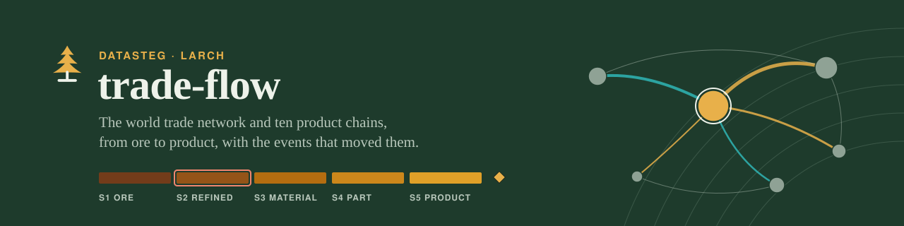
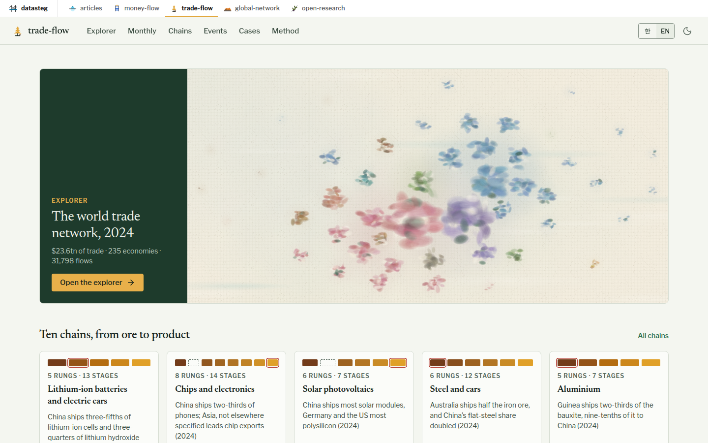
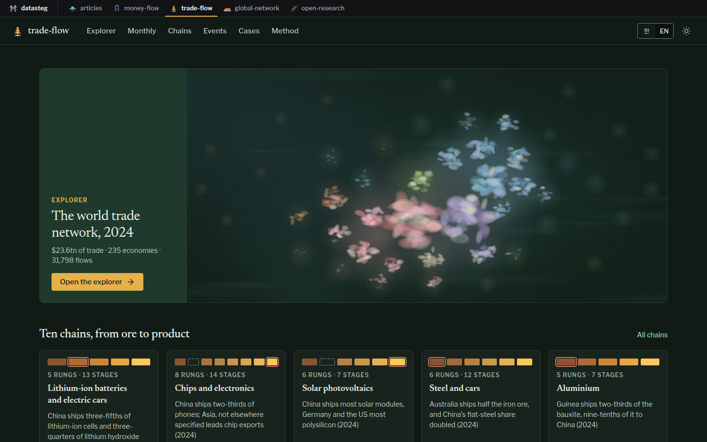
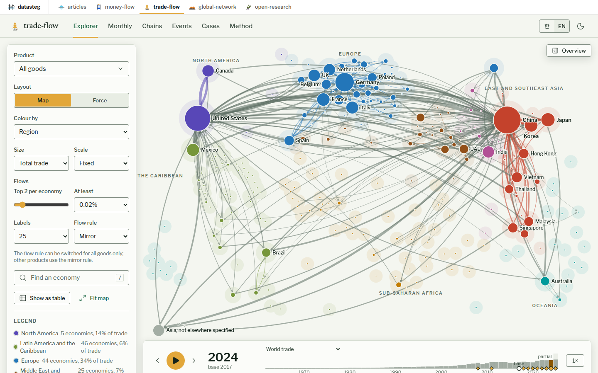
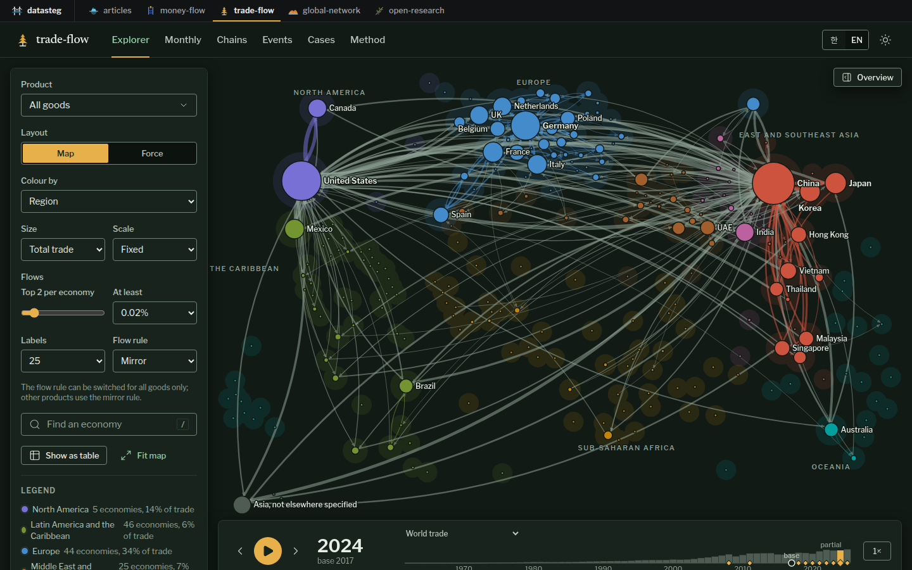
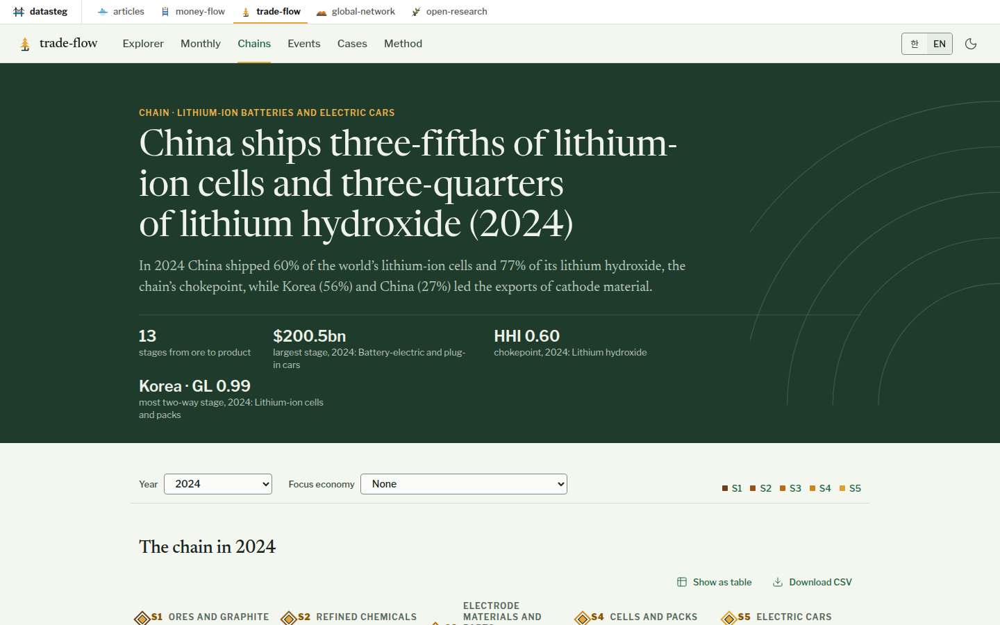

<p align="center"></p>

# trade-flow

**The world trade network, product by product, from UN Comtrade customs records.**
Live at **[trade-flow.datasteg.com](https://trade-flow.datasteg.com)**, in English and Korean.

trade-flow is one of the [datasteg](https://www.datasteg.com) sites. AI agents and plain code carry public trade
statistics from the publisher's bulk files through a ladder of checks to a bilingual site and a public API. This
repository is the source of the site as it runs today: the Next.js app, the Python builders that turn customs records
into the site's data, the checks, the configuration that describes chains, events and cases, the Larch design system,
and the agent skill that reviews event pages.

<p align="center">
  
  
</p>

## What the site shows

| Page | What it does |
|---|---|
| **Explorer** (`/explore`) | The trade network of one product and one year (all goods from 1962, products from 1995): every economy a node sized by its trade, the largest flows drawn between them, on a stretched world map or a force layout. Pick a product (all goods, an HS chapter, a basket or a chain stage), colour by region, trade bloc or network community, and read a flow card or an economy card. |
| **Monthly** (`/explore-monthly`) | The same network on rolling windows of 3, 6 or 12 months, with the months an importer did not file estimated from the exporter's report and drawn dashed. |
| **Chains** (`/chains`) | Ten supply chains from ore to product (lithium-ion batteries, chips, solar, steel and cars, aluminium, copper, rare-earth magnets, plastics, clothing, fertilisers), each a ladder of HS6 stages. Every stage shows who exports it, how concentrated it is (exporter HHI) and which stage is the chokepoint. |
| **Events** (`/events`) | Fourteen trade events, from the fall of Lehman Brothers in 2008 to the 2026 war that shut the Strait of Hormuz: a sourced timeline, what moved in the network before and after, and a "Reading the numbers" section that explains the figures that run against the headline. |
| **Cases** (`/cases`) | Nine case studies: a question from the economics literature, read against the network with quoted papers, measured numbers, Korea's place, and a first-round scenario. |
| **Cut a supplier** (`/cases/tools/cut-supplier`) | Pick an economy and a chain stage, cut its exports, and see which importers lose the largest share of their supply. First-round arithmetic on trade shares, not a forecast. |
| **Method** (`/method`, `/method/checks`) | How every number is made, the licence rule, and the result of every check, product by product. |

<p align="center">
  
  
</p>

## From data to publication

Each step is marked by who does the work: **code** (plain code, no model runs; AI agents wrote it), **agent** (a
model does the work on every run) or **person** (a person approves). The same marks are used on
[www.datasteg.com/en/technology](https://www.datasteg.com/en/technology), which lists every step and
[every AI agent](https://www.datasteg.com/en/technology/agents) on datasteg.

| # | Step | Who | Where |
|---|---|---|---|
| 1 | **Collect.** UN Comtrade bulk files (annual and monthly, final data) and Korea's customs data by item and country from data.go.kr are pulled by the trade collector, which keeps every revision and swaps in whole Parquet network tables. The collector lives in a separate repository and is not part of this one. | code | not in this repository |
| 2 | **Curate events.** The event catalogue (what happened and when, numbered sources, the reading of the numbers) is written by the event curator agent from official reports opened on the publishers' own pages, using the project skill `event-page-review`. Nothing on an event page may rest on the agent's own inference. The person running the session approves. | agent + person | [config/events.yaml](config/events.yaml), [.claude/skills/event-page-review](.claude/skills/event-page-review/SKILL.md) |
| 3 | **Case studies.** Each case quotes papers found in the research archive; every quoted phrase was checked against the paper's abstract or text. | agent + person | [config/cases.yaml](config/cases.yaml) |
| 4 | **Build snapshots.** One file per product and year: shares of world trade, ranks, mirror ratios, PageRank and communities, the chains' stages and ladders. The mirror rule takes the importer's report where it exists, else the exporter's times 1.06 (CIF/FOB). Korea's customs months fill only the reporter-months Comtrade lacks. | code | [scripts/build_snapshots.py](scripts/build_snapshots.py) |
| 5 | **Build monthly windows.** Rolling 3-, 6- and 12-month sums. A month the importer did not file is spliced from the exporter's report at the ratio of the two reports a year earlier, then benchmarked to the annual figure. | code | [scripts/build_windows.py](scripts/build_windows.py) |
| 6 | **Build stories and products.** Event and case pages, HS chapters by economy. | code | [scripts/build_stories.py](scripts/build_stories.py), [scripts/build_products.py](scripts/build_products.py) |
| 7 | **The ladder of checks.** Tier 0: Comtrade against itself (twelve monthly files against the annual file, mirror ratios, coverage, HS breaks). Tier 1: national customs (Bank of Korea export index, US Census imports via FRED). Tier 2: prices and output (IMF commodity prices, industrial production, unit values, exchange rates). Tier 3: firms (cathode makers' filed revenue; its source is private and not in this snapshot). Tier 4: physical balances (not yet). Tier 5: the papers' anchors. A check that cannot run is written as "not run", never as a pass. Three consistency checks fail the build. | code | [scripts/checks.py](scripts/checks.py), [scripts/tests](scripts/tests) |
| 8 | **The licence gate.** The site stores derived records only (shares, ranks, ratios) and the build fails if more than 90,000 original records would be published. The API views return no dollar value of any flow, economy or the world. | code | [scripts/tests/test_svc_licence.py](scripts/tests/test_svc_licence.py), [apps/web/lib/svc](apps/web/lib/svc) |
| 9 | **Korean.** Every Korean string comes from datasteg's Korean wording model and is checked at release against the record of what it wrote. | agent + code | [apps/web/lib/strings](apps/web/lib/strings) |
| 10 | **Publish.** The data travel inside the container image; a person builds and deploys each release. The pages, a feed, and the views behind the public API and MCP server are served by the same app. | person | [apps/web](apps/web), [api.yaml](api.yaml) |

The data contract of the built files (what each file holds and how to decode it) is in [docs/DATA.md](docs/DATA.md);
the explorer's map layout and the tests behind it are in [docs/MAP-LAYOUT.md](docs/MAP-LAYOUT.md).

<p align="center"></p>

## Repository map

```
apps/web/                 the Next.js site (App Router, server components; /[lang] pages, /svc/v1 API views, feed, OG images)
  app/[lang]/             explore, explore-monthly, chains, events, cases (and the cut-supplier tool), method
  components/             the explorer, chain pages, event and case stories, the home painting
  lib/                    data loading, i18n and the bilingual strings, SEO, the API views (lib/svc)
packages/net/             @larch/net: the D3 network views (NetView, map layout), the chart kit, the data types and loader
packages/ui/              @larch/ui: the Larch React components (masthead, controls, data tables, chain trail, signposts)
packages/fonts/           @larch/fonts: the self-hosted font stacks
packages/tokens-build/    design/tokens.json -> design/tokens.css
design/                   the Larch design system: tokens.json, tokens.css, larch.css
config/                   chains.yaml (ten chains, HS6 stages), events.yaml, cases.yaml, groups.yaml, names.yaml, memberships.csv
scripts/                  the Python builders, the checks and their tests (uv scripts with inline dependencies)
.claude/skills/           event-page-review: the agent skill that critiques and refines an event page
docs/                     DATA.md (the data contract), MAP-LAYOUT.md (the map layout study)
api.yaml                  the views trade-flow offers to the datasteg API and MCP server
```

## The Larch design system

Larch is trade-flow's design system, named after the larch, the conifer whose needles turn gold in October: a
forest-floor palette of mist, lichen and spruce, one gold (`larch`) for action and focus, one red (`rowan`) for
chokepoints, a gold-to-bark ramp for the stages of a chain, and maps drawn like topographic sheets. The tokens are
in [design/tokens.json](design/tokens.json); see [DESIGN.md](DESIGN.md) for the palette, type, map and chart
conventions and the components.

## Use the data

Use the site, or ask for the numbers through the public API and MCP server:
[www.datasteg.com/en/technology/api](https://www.datasteg.com/en/technology/api)
(REST at `https://api.datasteg.com/v1`, MCP at `https://mcp.datasteg.com/mcp`; read-only, no sign-in). trade-flow's
views give an economy's partners, a bilateral flow, a chain, an event, a case and the cut-supplier scenario.

## About this snapshot

This is a read-only snapshot of the source, published to show how the site is built. It is not set up to run on its
own: the builders read the trade collector's network tables and validator series that are not part of this
repository, and no data are included. datasteg publishes derived results only and does not redistribute source data;
UN Comtrade and the Korea Customs Service remain the sources of the records behind every number.

© datasteg. All rights reserved.
